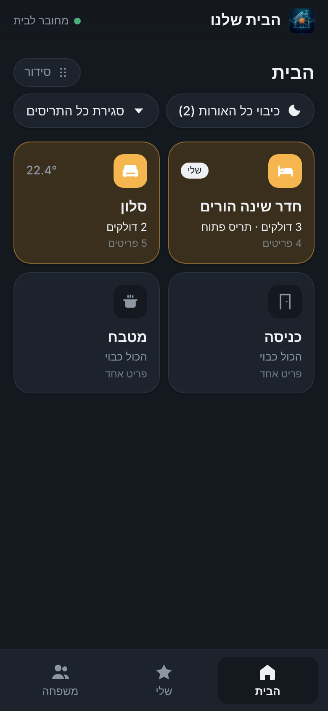
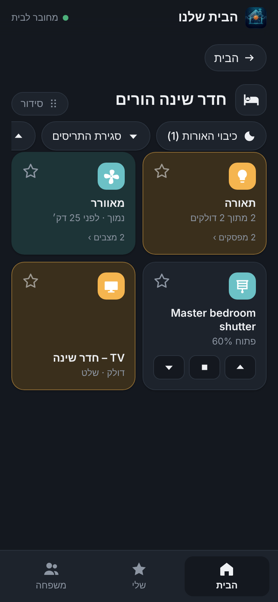
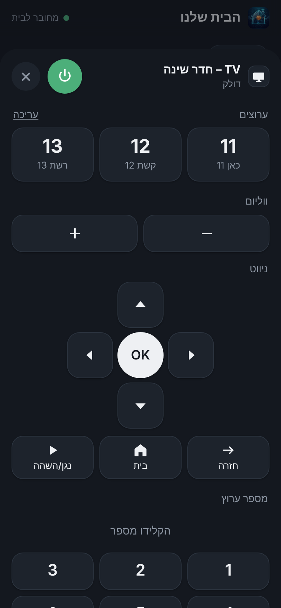
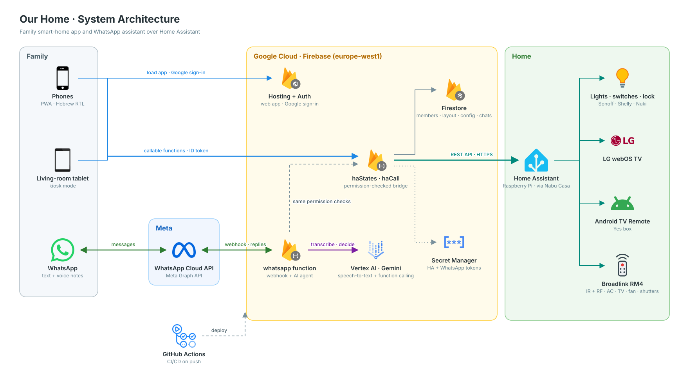
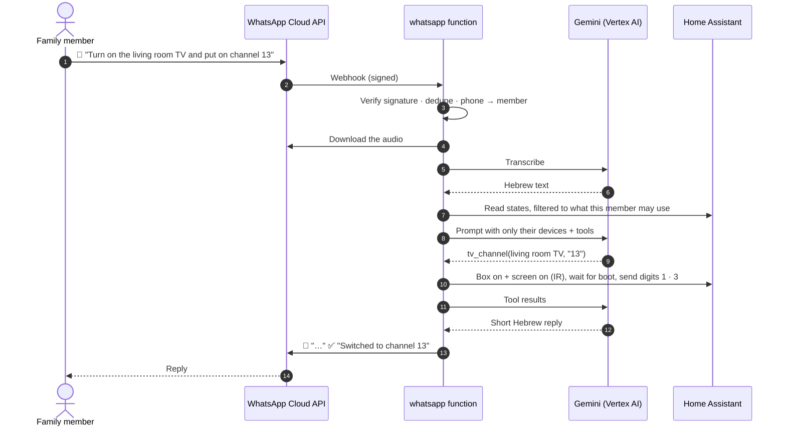

<div align="center">


# הבית שלנו · Our Home

**A family-first control layer for Home Assistant: a Hebrew, RTL web app plus an AI WhatsApp assistant that understands text and voice.**

[](https://github.com/codoron/home-app/actions/workflows/deploy.yml)


</div>

---

Home Assistant is great for the person who sets it up and too much for everyone else. **הבית שלנו** puts a simple, personal and safe interface on top of it for the whole family. Each member signs in with Google, gets their own room and favourites, and only sees what they are allowed to control. A shared tablet in the living room runs the whole house. Anyone in the family can also just send a WhatsApp message or a voice note: *"turn on the TV in the living room and put on channel 13"*.

<div align="center">
&nbsp;&nbsp;
&nbsp;&nbsp;

</div>

## ✨ Highlights

| | |
|---|---|
| 🏠 **House → room → device** | Rooms come straight from Home Assistant areas, with live summaries ("2 on · shutter open"), temperature, and house-wide quick actions (all lights off, all shutters up/down). |
| 🧩 **Smart grouping** | Raw entities are folded into human cards: one **Lights** card per room, one **AC** and **Fan** card built from IR scripts (with the last command remembered), and a single **TV** card. Unavailable devices are tucked away. |
| 📺 **A real TV remote** | One sheet joins three integrations: Android TV Remote (the Yes box: D‑pad, channels by digits), Broadlink IR (screen power, volume, mute), and a shared, editable favourite-channel list. |
| 👨‍👩‍👧‍👦 **Per-member experience** | Google sign-in by invitation, roles (parent / child / tablet), personal favourites, and a drag‑and‑drop personal arrangement of rooms, cards and switches. |
| 📟 **Living-room tablet mode** | Clock and status header, screen wake lock, automatic return to the house view after 60 s idle, slower polling when idle. |
| 💬 **WhatsApp assistant** | Gemini with function calling turns free Hebrew text **or voice notes** into device actions, using exactly the same permission checks as the app. Door unlocks need an explicit "כן". |
| 🔐 **Secure by design** | The browser never talks to Home Assistant. All calls go through Cloud Functions that check identity, role, room and a per-domain service whitelist. Secrets live only in Secret Manager. |
| 🚀 **Zero-touch delivery** | Push to `main`, and GitHub Actions deploys hosting, Firestore rules and functions. |

## 🏗️ Architecture

<p align="center"></p>

<sub>Also as a <a href="docs/architecture.png">PNG</a>.</sub>

### What happens when someone sends a voice note



## 🔐 Security model

| Role | Sees and controls | Notes |
|---|---|---|
| **Parent** | The whole house | Can manage members, shared rooms and the channel list. |
| **Tablet** | The whole house | A shared account for the living-room screen. Ignored by the WhatsApp bot. |
| **Child** | Their own room + shared rooms (+ extra rooms a parent grants) | Locks are parent-only. A child chooses their room once. |

- **One enforcement point.** `haStates` returns only the entities a member may see, and `runCalls` re-validates every action (entity, domain, service) before it reaches Home Assistant, for both the app and WhatsApp.
- **Whitelisted services** per domain (e.g. `cover: open/close/stop`, `lock: lock/unlock`, `remote: send_command` limited to a known key set).
- **Firestore rules** let members change only their own `favorites`, `room` and `layout`. Everything else is admin-only.
- **WhatsApp:** requests are verified with `x-hub-signature-256`, unknown numbers get no reply, messages are de-duplicated, and unlocking a door needs a typed or spoken "כן" within 3 minutes.
- **Secrets** (`HA_URL`, `HA_TOKEN`, WhatsApp tokens) are stored in Secret Manager and never sent to the client.

## 🧰 Tech stack

| Layer | Technology |
|---|---|
| Frontend | Vanilla JS modules, CSS (light and dark), Firebase JS SDK 10, SortableJS. No framework and no build step. |
| Backend | Cloud Functions for Firebase v2 (Node 22), Firestore, Firebase Auth, Secret Manager |
| AI | `@google/genai` on Vertex AI: Gemini 3.8 Flash for intent, function calling and speech-to-text |
| Messaging | WhatsApp Business Cloud API (Graph API v25) |
| Smart home | Home Assistant over Nabu Casa, Broadlink (IR/RF), Android TV Remote, Sonoff, Shelly, Nuki, LG webOS, Google Cast |
| CI/CD | GitHub Actions → `firebase deploy` (hosting, rules, functions) |

## 📁 Repository layout

```
public/            The web app (index.html, app.js, style.css, config.js, PWA manifest and icons)
functions/
  index.js         haStates / haCall: the permission-checked bridge to Home Assistant
  whatsapp.js      WhatsApp webhook: signature check, Gemini tools, voice transcription
firestore.rules    Data access rules
ha/packages/       Home Assistant package files (Broadlink IR/RF scripts) created for this project
docs/              Screenshots
.github/workflows/ deploy.yml: CI/CD
```

## ⚙️ Running and deploying

<details>
<summary><b>Deploy</b></summary>

Every push to `main` runs `.github/workflows/deploy.yml`, which deploys Firebase Hosting, Firestore rules and Cloud Functions using a deploy-only service account. If the deploy fails, the errors are published as workflow annotations.
</details>

<details>
<summary><b>Configuration</b></summary>

| Secret (Secret Manager) | Purpose |
|---|---|
| `HA_URL`, `HA_TOKEN` | Home Assistant base URL and long-lived token (an admin user is needed for `/api/template`) |
| `WA_TOKEN`, `WA_APP_SECRET`, `WA_VERIFY` | WhatsApp Cloud API token, app secret (signature check), webhook verify token |

Optional Firestore `config/app` fields: `sharedAreas`, `channels`, `geminiModel`. The function runtime service account needs `roles/aiplatform.user`.
</details>

<details>
<summary><b>Local checks</b></summary>

- `node --check` on all JS.
- UI: rendered with Playwright, with the Firebase SDK imports routed to small mock modules that serve a fake house.
- Functions: a Node harness with fake `firebase-admin`, a scripted fake Gemini, and mocked Home Assistant and Graph endpoints. It covers permissions, unlock confirmation, voice notes and TV power sequencing.
</details>

<details>
<summary><b>Rotating the Home Assistant token</b></summary>

```bash
read -s HA_TOKEN   # paste, then Enter
printf '%s' "$HA_TOKEN" | gcloud secrets versions add HA_TOKEN --data-file=- --project=home-app-f94e4; unset HA_TOKEN
```
Then redeploy the functions (any change under `functions/`).
</details>

---

<div align="center">
Built with ❤️ for one family and its very opinionated smart home.
</div>
